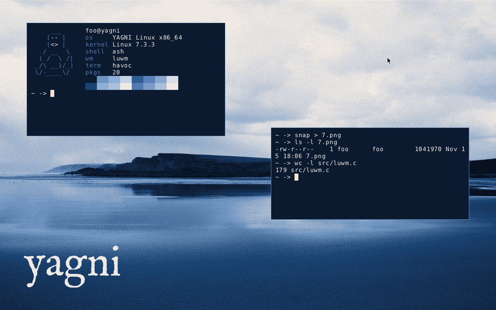

# luwm

the low usage window manager. a floating [wayland](https://wayland.freedesktop.org) compositor in one c file, built on [swc](https://github.com/michaelforney/swc). 4 workspaces, no bar.



## install

on yagni:

```sh
jits a luwm
startw
```

anywhere else, build swc with the three patches in `patches/` (simpledrm, software cursor and pointer position, wallpaper and snapshot), then:

```sh
make SWC=/path/to/swc
make install
swc-launch -- luwm
```

## keys

| key                   | action                      |
| --------------------- | --------------------------- |
| `super + return`      | open havoc (`$TERMINAL`)    |
| `super + d`           | open dmenu_run (`$MENU`)    |
| `super + q`           | close the focused window    |
| `super + shift + q`   | quit luwm                   |
| `super + tab`         | raise the bottom window     |
| `super + grave`       | lower the focused window    |
| `super + f`           | toggle fullscreen           |
| `super + 1-4`         | switch workspace            |
| `super + shift + 1-4` | send the window there       |
| `super + left drag`   | move                        |
| `super + right drag`  | resize                      |
| `super + middle click`| lower the window            |

## config

`startw` loads `~/.config/luwm/env`:

```
LUWM_BORDER=6
LUWM_FOCUS=3d6fa3
LUWM_UNFOCUS=253e5b
TERMINAL=havoc
MENU=dmenu_run
```

`~/.config/luwm/keys` is a shell script. `super + x` runs it with `x`, `super + shift + x` with `S-x`:

```sh
case $1 in
w) exec netsurf ;;
esac
```

anything else, edit `luwm.c` and recompile.

## license

CDDL 1.1, see LICENSE.
